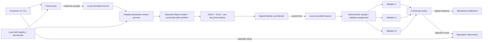

# AI Mining Network

Open-source reference MVP for fixed-price AI jobs with partitioned output commitments, post-commit sample verification, signed evidence, and idempotent settlement.

> **Status: local development MVP; not a production decentralized network.** The local demo executes the full protocol on one host. Ollama is a real local inference adapter; local SQLite, a simulated randomness beacon, and Python settlement are development adapters. A Hardhat test chain runs an OpenZeppelin escrow contract independently from the Python demo. Golem, libp2p, Helia/IPFS, OrbitDB, drand verification, and EAS are not wired into the runtime yet. No real funds or proprietary token are used.

## What is implemented

- A content-addressed Agent Skill package with a signed author manifest and local publish/discover CLI.
- Strict SKILL.md/manifest parsing, inline input/output JSON Schema validation, package path/size/reference checks, and a V2 digest binding the manifest and package assets.
- A declarative skill runtime with a killable worker process, process-tree CPU/RSS/deadline monitoring, bounded inputs/outputs, structured errors, cancellation, scratch workspace, sanitized environment, and versioned `ollama.chat@1.0.0`. Downloaded package scripts are never run.
- A signed 20-sample invoice benchmark receipt for the invoice skill/model digest. General document-task quotes use a disclosed local text-size/model-size estimate; they do not claim an executed skill benchmark.
- Fixed integer-atomic quotes selected from compatible local offer records. The accepted quote is the maximum charge.
- A workflow builder with a fixed Input node for prompt/files/model, a node library and skill-text inspector, connectable skill nodes, and a fixed Final output node. Drag supported files onto Input, add skills from the library, connect each skill from Input or an earlier node, and review the fixed summed quote before execution.
- Private per-document input units, schema-constrained Ollama results, JSON and formula-safe XLSX artifacts, Merkle commitment, independent sample replay, signed receipts, and local settlement. The invoice extraction skill remains available as one selectable skill; `document-assistant` supports general document prompts.
- Per-invoice execution units and a Python Merkle tree whose root matches OpenZeppelin `StandardMerkleTree` for a cross-language golden vector.
- Random sample and validator selection after commitment. Local randomness is explicitly marked **unverified**; assignments and receipts are EIP-712 signed.
- Independent sample re-extraction, evidence-bearing receipts, explicit pass/fail/inconclusive/disputed decisions, validator conflict escalation, and a receipt audit CLI.
- A Python idempotent settlement ledger and an independently tested OpenZeppelin EVM escrow contract using an existing ERC-20 interface. The test-only `TESTUSD` asset is never a production currency.
- A loopback customer web UI, miner capability CLI, validator capability/audit CLI, MCP tool server (optional dependency), synthetic fault scenarios, event hash chain, reputation aggregators, and reproducible local protocol benchmark.

The demo verifies synthetic labeled invoice PDFs using both independent extraction and exact source-field evidence. It does not provide OCR or claim general-purpose correctness for arbitrary invoice layouts. A Merkle proof establishes that a unit was committed; it does **not** prove that AI inference occurred or that unsampled units are correct.

## Architecture



See [architecture](docs/architecture/architecture.md), [protocol](docs/protocol.md), [security model](docs/security/threat-model.md), and the [integration matrix](docs/architecture/integration-matrix.md).

## Requirements

- Python 3.10+ (Python 3.12 recommended), Git.
- Node.js 20+ and pnpm 11 for the UI, protocol compatibility test, and Hardhat contracts.
- Ollama running with at least one installed model for the customer UI's general document workflow. The UI lists every model exposed by the configured Ollama `/api/tags` endpoint and does not silently switch models or providers.
- No Docker, cloud account, blockchain RPC, wallet funds, or production infrastructure is needed for tests.

## Install and run (PowerShell)

From this repository:

```powershell
py -3.12 -m venv .venv
.\.venv\Scripts\Activate.ps1
python -m pip install -e ".[dev]"
pnpm install
```

This Python and pnpm setup is sufficient for the offline test suite. The pnpm
workspace explicitly permits install scripts only for `esbuild` (which checks
its platform binary hash) and `keccak` (which has a JavaScript fallback); these
are required by the web build and local EVM test dependencies.

To run the local inference demo, install Ollama separately and pull a model
supported by the selected skill:

```powershell
ollama pull qwen3:4b-instruct
```

To run one non-sensitive prompt through the isolated skill worker and check the
installed model's structured response:

```powershell
python scripts/smoke_ollama_worker.py --model qwen3:4b-instruct
```

In terminal 1, start the loopback API:

```powershell
amn-web --host 127.0.0.1 --port 8001
```

In terminal 2, start the local customer UI:

```powershell
pnpm dev:web
```

Open `http://127.0.0.1:5173`. The API binds only to loopback and rejects non-loopback `Host` and `Origin` headers. The customer UI uses a horizontal graph canvas with an **Input** node for the prompt, installed Ollama model selector, and private file drop area; a searchable skills library with descriptions, input/output schemas, current values, and full `SKILL.md`; and a **Final output** node. Add skills from the library, connect each skill from Input or an earlier skill, then choose **Run workflow** to calculate a fixed quote. The quote lists the skill execution costs, verification budget, and fee; execution starts only after the customer approves it. **Save** stores only the named graph and its skill version hashes in local `.amn/workflows.sqlite3`; prompts and uploaded files are never included in saved workflow records. **My Workflows** loads saved graph templates. Supported uploads are text-based PDF, TXT, Markdown, CSV, and JSON (100 files maximum, 10 MiB each, 25 MiB total); image OCR and scanned PDFs are not supported. Prompt-only requests are also supported as one task unit.

Saved workflow templates are exposed through `GET /api/workflows`, `GET /api/workflows/{workflowId}`, and `POST /api/workflows`. The local registry validates the graph, stores the skill version/hash references with it, and returns a canonical SHA-256 content hash that binds the workflow name, graph, and skill references. Updates use the server-issued workflow UUID. It is a single-node local development adapter; decentralized registry replication is a separate integration step.

The local `/api/models` route discovers the full model list from Ollama. To point the app at a non-loopback Ollama endpoint, set `OLLAMA_HOST` to an HTTPS origin and explicitly set `AMN_ALLOW_REMOTE_OLLAMA=1`; this sends task text to that endpoint, so enable it only when that data sharing is authorized. Skills that require per-task GPU/VRAM or arbitrary network access are rejected by the local Ollama worker. The local quote is an estimate in valueless `TESTUSD`, calculated from prompt/document text size, model-size throughput heuristic, and verification work. It is not a live miner offer or a measured benchmark guarantee. The currently implemented `document-assistant` and `invoice-extractor` packages are declarative `SKILL.md` instructions; the runtime does not execute downloaded package code.

After editing a skill package, refresh its manifest hash before publishing it:

```powershell
python scripts/update_skill_hash.py skills/document-assistant
amn publish-skill skills/document-assistant
```

The digest binds the canonical manifest and every package file except the root `manifest.json` self-reference. AMN currently accepts the protocol's safe-integer canonical JSON subset; use integer minor units or exact decimal strings for fractional amounts.

The CLI can run the same customer flow without the UI:

```powershell
amn publish-skill
amn discover-skills invoice
amn benchmark --samples 20
amn demo --count 100 --samples 30 --validators 3
# To accept without the prompt:
amn demo --accept --count 100 --samples 30 --validators 3
```

CLI scenario flags: `--corrupt 3`, `--unavailable-validator 0`, `--disagree`, `--tamper-after-commit`, and `--timeout`. A deliberate corruption is detected only if a corrupted unit is sampled. `--samples 100` makes the small synthetic fault demonstration deterministic. A disagreement remains disputed and keeps the simulated quote unresolved for an additional audit.

Local role tools:

```powershell
amn-miner capabilities
amn-validator capabilities
amn-validator audit <task-id>
amn fraud-report --units 100 --corrupt 5 --samples 5 10 20 30 50
```

`capabilities` writes a signed, stable local identity advertisement under `.amn/capabilities`. It does not join or announce to a P2P network. `amn-validator audit` verifies the signed execution commitment, receipt signature and validator identity binding, evidence hash, and each receipt's Merkle inclusion proof.

Optional MCP v2 tool server (`stdio`, local Ollama by default; Python 3.11+):

```powershell
python -m pip install -e ".[mcp]"
amn-mcp
```

It exposes `amn_skill_execute_v1` for published declarative skills and keeps `extract_invoice_v1` as a compatibility tool. The server supports `AMN_ROOT`, `AMN_OLLAMA_MODEL`, and `OLLAMA_HOST`; remote HTTPS inference also requires `AMN_ALLOW_REMOTE_OLLAMA=1`.

## Tests and reproducible reports

Run the full local suite after activating the Python virtual environment:

```powershell
pnpm test:all
```

Or run parts individually:

```powershell
python -m pytest
node --test apps/customer-web/tests/*.test.mjs
pnpm test:contract
pnpm build:web
```

The Python end-to-end tests inject the explicitly test-only deterministic extractor to cover protocol behavior without Ollama. The web/customer CLI never chooses that extractor. Contract tests use Hardhat's ephemeral EVM and a test-only ERC-20.

Generate the local mechanics performance report and exact sampling curve:

```powershell
python scripts/performance_report.py
```

Outputs are in [`docs/reports`](docs/reports/): fixture protocol timings, proof/storage sizes, a CSV, and an SVG fraud-detection curve. The fixture report is not an AI inference benchmark or real cost estimate. `amn benchmark --samples 20` runs and signs a local invoice benchmark under `.amn/benchmark-contribution/`; invoice-demo quote creation runs and caches its 20-document benchmark under `.amn/benchmark/`. General document-task UI quotes use the disclosed local rate-card estimate above, not that invoice benchmark.

## Local data and trust boundaries

- `.amn/jobs/<task-id>/private-input/` holds customer uploads and (for the invoice demo) synthetic PDFs and ground truth. It is excluded from the artifact API. Local files are not encrypted; use OS disk protection.
- Public skill content and benchmark receipts are separate from private job inputs. By default, task inputs are not sent to IPFS, OrbitDB, or a remote model. Remote Ollama is an explicit HTTPS opt-in through `AMN_ALLOW_REMOTE_OLLAMA=1`.
- Local EIP-712 keys under `.amn/identities/` and job signing keys are development keys. Do not fund them or reuse them in production.
- Ollama requests are constrained to localhost by default. Setting `AMN_ALLOW_REMOTE_OLLAMA=1` with an HTTPS `OLLAMA_HOST` explicitly permits remote data sharing. The configured Ollama catalog may then expose remote-hosted Ollama models.
- The local beacon is generated in-process and cannot establish independent unpredictable randomness. Validator accounts are separate keys but run in the same host process; this is not a Sybil-resistant validator set.
- Settlement ratings are payment-neutral. A low rating after valid execution changes only skill-quality reputation.

## Integration status and production readiness

| Component | Current status |
|---|---|
| Ollama | Real configured `/api/tags` discovery and `/api/chat` schema-constrained tasks; loopback is the default |
| Agent Skills | Safe frontmatter/manifest validation, manifest-bound package digest, and content-addressed local registry |
| MCP Python SDK | Tested MCP v2 skill server; install with `[mcp]` on Python 3.11+ |
| OpenZeppelin Merkle Tree | Python implementation cross-checked against a Node golden vector |
| OpenZeppelin Contracts / EVM | Local escrow contract and Hardhat tests; not connected to Python settlement |
| Golem Yagna | Not connected; support constraints and adapter requirements documented |
| Helia/IPFS + OrbitDB | Not connected; local public registry adapter is SQLite |
| libp2p | Not connected; local API is loopback-only |
| drand | Not connected; challenge adapter is simulated and says `verified: false` |
| EAS | Not connected; receipt files use local EIP-712 signatures |

Do not treat this repository as production-ready. The local worker has monitored CPU/RSS/deadline limits, a scratch working directory, and a sanitized environment; it is not an OS sandbox. It runs under the miner's user permissions, does not enforce filesystem/kernel network isolation, and cannot meter GPU/VRAM or the separate Ollama daemon. Before real deployment, replace local adapters, harden execution in a container/VM, verify random-beacon proofs and validator eligibility, add encrypted private-artifact transport, distributed availability/recovery, production signer/key management, and independent security review. See the [production checklist](docs/production-readiness.md).

## License

Project code is MIT-licensed. See [LICENSE](LICENSE) and the generated [dependency license report](docs/reports/dependency-licenses.md). Direct dependencies retain their own license terms.
