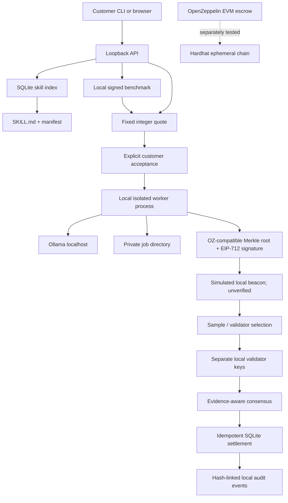
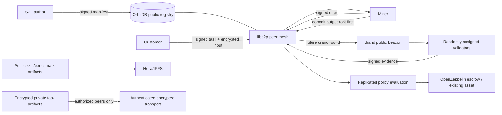

# Architecture

## Current local MVP

The executable reference composition is a Python `DemoService`, a loopback-only standard-library HTTP API, a React/Vite customer UI, local Ollama inference, a SQLite registry/event log, and a separate Hardhat Solidity test target. `DemoService` composes customer, miner, and validator roles on one host so the end-to-end protocol is reproducible without cloud services.

The Ollama HTTP path and the P3/P4 libp2p and Helia adapters are actual external-project integrations, but the latter two are standalone packages and are not in the task runtime composition. Local EVM contract tests also use OpenZeppelin Contracts. The Python demo uses `SimulatedBeacon`, local synthetic offers, and a local settlement ledger. The EVM escrow is not called by the Python demo.

## Decentralized deployment target

The future deployment removes any required central scheduler. Peers publish signed skills, offers, capability announcements, task commitments, assignments, receipts, and attestations through exchangeable networking/storage adapters. Nodes independently validate the protocol, use public randomness after output commitment, and derive the same eligible validator/sample set. Settlement uses an existing asset and an EVM escrow or equivalent supported payment rail. The scheduler is a convenience cache and can be replaced by peers deriving work directly from signed announcements.

This target is a design, not an end-to-end deployment. P3 provides a separately tested libp2p peer transport; P4 provides a separately tested Helia artifact store for public content and encrypted private bytes. Neither adapter is yet wired into the customer/miner task path. Helia local pins do not guarantee global persistence. OrbitDB is not integrated; its eventual consistency will require deterministic conflict rules for public metadata and will not make private data confidential.

## Local modules and seams

- `models.py`: Pydantic v2 wire payloads wrapped in signed protocol envelopes.
- `canonical.py` / `signing.py`: integer-safe canonical JSON hashes and EIP-712 message signatures.
- `skill_packages.py` / `registry.py`: safe YAML/JSON parsing, Agent Skills metadata validation, JSON Schema validation, package path/size/reference checks, manifest-bound V2 digest, and local SQLite search index.
- `worker.py` / `skill_worker.py` / `tool_runtime.py`: killable declarative worker process, process-tree CPU/RSS/deadline monitoring, scratch workspace and sanitized environment, structured output validation, and the versioned `ollama.chat@1.0.0` tool contract. Downloaded skill scripts are never invoked.
- The customer workflow graph fixes Input and Final output nodes, connects one to ten unique skill nodes in an acyclic graph, and commits its topology plus skill package hashes through `CustomerTask.workflowHash`. The current editor supports one upstream connection per skill node and joins terminal branches at Output.
- `benchmark_service.py`: measured per-document runs; benchmark receipts say `selfReportedMetrics: true`.
- `pricing.py`: selects the cheapest unexpired currency-compatible executor and validator offers; hard cap checked before quote creation.
- `invoice.py`: synthetic dataset, PDF text loading, local Ollama JSON-schema extraction, normalized JSON and XLSX.
- `merkle.py`: OpenZeppelin StandardMerkleTree-compatible three-`bytes32` leaves and proofs.
- `randomness.py`: `RandomnessSource` interface and `SimulatedBeacon`; the simulated implementation cannot be trusted as public randomness.
- `verification.py`: synthetic source-line evidence, independent extraction, proof check, explicit consensus outcome.
- `settlement.py`: objective payout policy, Python SQLite idempotency key.
- `TaskEscrow.sol`: OpenZeppelin SafeERC20/ReentrancyGuard/EIP712/ECDSA escrow primitive. It does not verify drand proofs or validator selection.
- `packages/networking`: standalone libp2p TCP/Noise peer transport, signed public event sync, and encrypted authorized direct RPC; it has not been wired into API/miner/validator orchestration.
- `packages/storage`: standalone persistent Helia/UnixFS/Bitswap artifact adapter. Public writes are explicit and kind-limited; private artifacts use authenticated encryption and recipient key envelopes. See [artifact storage](artifact-storage.md); the customer task flow does not yet call this package.

The local APIs are deliberately narrow and the network/compute/storage/payment adapters are replaceable. A production adapter must pass the exact same protocol and adversarial test suite before replacing a local implementation.

## Component lifecycle

1. The author publishes a `SKILL.md` + manifest package. Its V2 SHA-256 package digest includes the canonical manifest without `contentHash` and every package file except the self-referencing root manifest.
2. The customer describes a task and receives an expiring quote from available compatible offers.
3. The customer explicitly accepts. The execution contract pins quote, executor, deadline, challenge round, and idempotency key.
4. The miner checks each input hash, validates the signed workflow graph, runs connected skill nodes in topological order, joins terminal node values at Final output, writes per-document records, then signs a Merkle root and artifact-manifest hash.
5. Only after commitment, the local adapter derives a random-looking challenge and deterministically assigns distinct sampled units to validator identities.
6. Each validator independently extracts its assigned inputs, compares exact normalized fields, verifies leaf membership, and signs an evidence receipt.
7. Consensus resolves a full pass, source-proven failure, inconclusive shortfall, or conflicting evidence. Disputes do not pay the miner automatically.
8. Settlement pays only from quoted atomic integers. Customer ratings do not enter settlement. The event log hashes each append in a per-task chain.

## Resource boundaries

The test API binds only on loopback and rejects DNS-rebinding-style non-loopback hosts/origins. Each JSON API body is limited to 1 MiB; MCP arguments are limited to 1 MiB; skill packages are limited to 10 MiB, 1,024 files, and 500 lines of `SKILL.md`; Ollama requests have deadlines and use localhost by default. The local MVP supports declarative skills only: uploaded scripts are treated as inert package data. A separate Python worker receives bounded JSON over stdin, runs with a scratch working directory and sanitized environment, and is killed on its deadline or monitored CPU/RSS limit. Its output and tool input/output sizes are bounded. Explicit per-task GPU/VRAM or arbitrary network requirements are rejected by the local Ollama adapter.

This process boundary is not an OS sandbox. The worker runs as the miner's OS account and can access files that account can access; `cwd`, `HOME`, and `TMPDIR` do not enforce a filesystem jail. Its network restriction is an application-level allow-list, not a kernel firewall. Ollama inference occurs in a separate daemon, outside worker CPU/RSS accounting and deadline termination, and its VRAM cannot be reserved or metered per task. These limitations are tested and remain production blockers; do not enable downloaded script execution.
