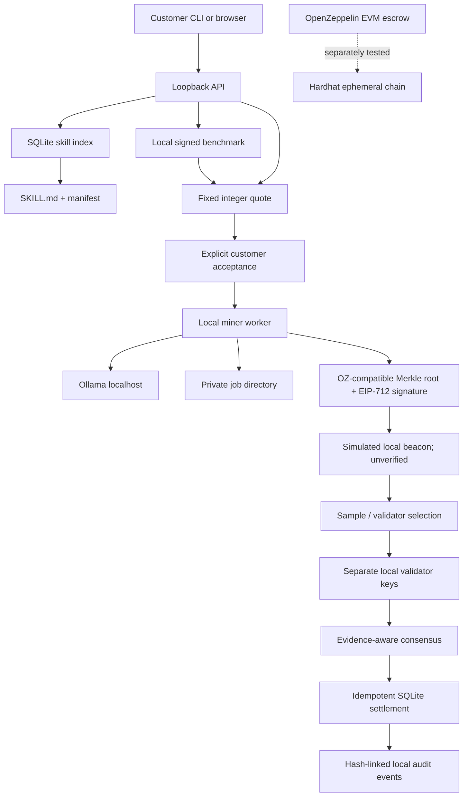
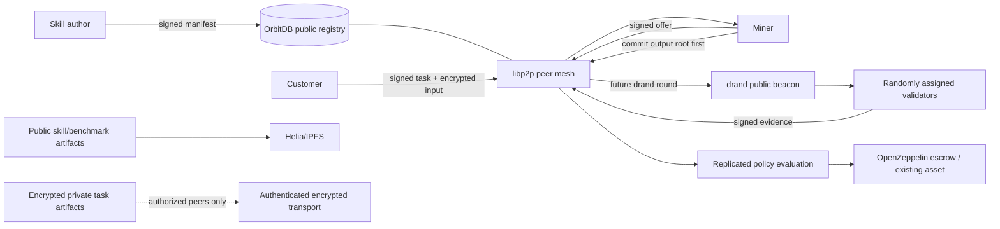

# Architecture

## Current local MVP

The executable reference composition is a Python `DemoService`, a loopback-only standard-library HTTP API, a React/Vite customer UI, local Ollama inference, a SQLite registry/event log, and a separate Hardhat Solidity test target. `DemoService` composes customer, miner, and validator roles on one host so the end-to-end protocol is reproducible without cloud services.

Only the Ollama HTTP path and local EVM contract tests are actual external-project integrations. The Python demo uses `SimulatedBeacon`, local synthetic offers, and a local settlement ledger. The EVM escrow is not called by the Python demo.

## Decentralized deployment target

The future deployment removes any required central scheduler. Peers publish signed skills, offers, capability announcements, task commitments, assignments, receipts, and attestations through exchangeable networking/storage adapters. Nodes independently validate the protocol, use public randomness after output commitment, and derive the same eligible validator/sample set. Settlement uses an existing asset and an EVM escrow or equivalent supported payment rail. The scheduler is a convenience cache and can be replaced by peers deriving work directly from signed announcements.

This target is a design, not code that currently runs. Helia/OrbitDB content must not contain private inputs unless a customer explicitly authorizes it. OrbitDB's eventual consistency requires deterministic conflict rules for public metadata and does not make private data confidential.

## Local modules and seams

- `models.py`: Pydantic v2 wire payloads wrapped in signed protocol envelopes.
- `canonical.py` / `signing.py`: integer-safe canonical JSON hashes and EIP-712 message signatures.
- `registry.py`: content hash of sorted package file paths and bytes; local SQLite search index.
- The customer workflow graph fixes Input and Final output nodes, connects one to ten unique skill nodes in an acyclic graph, and commits its topology plus skill package hashes through `CustomerTask.workflowHash`. The current editor supports one upstream connection per skill node and joins terminal branches at Output.
- `benchmark_service.py`: measured per-document runs; benchmark receipts say `selfReportedMetrics: true`.
- `pricing.py`: selects the cheapest unexpired currency-compatible executor and validator offers; hard cap checked before quote creation.
- `invoice.py`: synthetic dataset, PDF text loading, local Ollama JSON-schema extraction, normalized JSON and XLSX.
- `merkle.py`: OpenZeppelin StandardMerkleTree-compatible three-`bytes32` leaves and proofs.
- `randomness.py`: `RandomnessSource` interface and `SimulatedBeacon`; the simulated implementation cannot be trusted as public randomness.
- `verification.py`: synthetic source-line evidence, independent extraction, proof check, explicit consensus outcome.
- `settlement.py`: objective payout policy, Python SQLite idempotency key.
- `TaskEscrow.sol`: OpenZeppelin SafeERC20/ReentrancyGuard/EIP712/ECDSA escrow primitive. It does not verify drand proofs or validator selection.

The local APIs are deliberately narrow and the network/compute/storage/payment adapters are replaceable. A production adapter must pass the exact same protocol and adversarial test suite before replacing a local implementation.

## Component lifecycle

1. The author publishes a `SKILL.md` + manifest package. Its deterministic SHA-256 package digest excludes only `manifest.json` to avoid self-reference.
2. The customer describes a task and receives an expiring quote from available compatible offers.
3. The customer explicitly accepts. The execution contract pins quote, executor, deadline, challenge round, and idempotency key.
4. The miner checks each input hash, validates the signed workflow graph, runs connected skill nodes in topological order, joins terminal node values at Final output, writes per-document records, then signs a Merkle root and artifact-manifest hash.
5. Only after commitment, the local adapter derives a random-looking challenge and deterministically assigns distinct sampled units to validator identities.
6. Each validator independently extracts its assigned inputs, compares exact normalized fields, verifies leaf membership, and signs an evidence receipt.
7. Consensus resolves a full pass, source-proven failure, inconclusive shortfall, or conflicting evidence. Disputes do not pay the miner automatically.
8. Settlement pays only from quoted atomic integers. Customer ratings do not enter settlement. The event log hashes each append in a per-task chain.

## Resource boundaries

The test API binds only on loopback and rejects DNS-rebinding-style non-loopback hosts/origins. Each JSON API body is limited to 1 MiB; MCP invoice text is limited to 100 KB; Ollama requests have a timeout and a localhost-only default. The local MVP executes no downloaded skill code: a skill is declarative instructions plus manifest, and the repository's fixed runtime owns parsing and extraction. A production miner must still isolate parsers, model processes, downloaded tools, filesystem access, GPU access, and outbound networking before accepting third-party skills.
