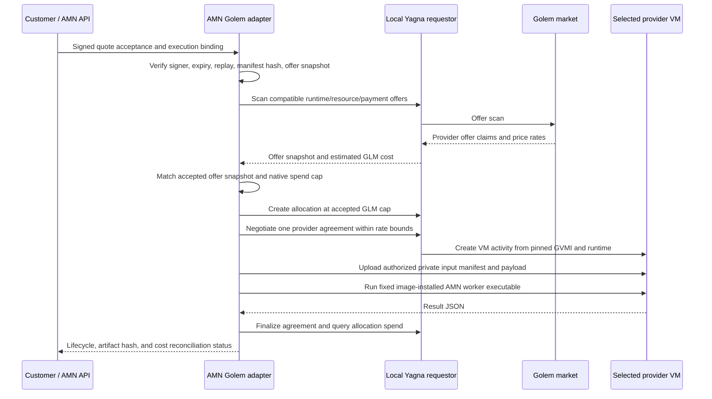

# P7: Golem Yagna compute backend

## Request and execution path



The deployment does not require a central marketplace coordinator: Yagna is the
requestor-to-Golem-network interface, while the AMN customer service signs the
execution terms and owns its local identity, replay and job records.

## Binding and state

`ExecutionContract.backendBinding` signs the backend choice, selected provider
offer ID, selected provider ID, canonical offer-snapshot hash, accepted AMN
quote total, execution reward, currency, runtime name/version, optional pinned
Golem image digest, input-manifest hash, resource requirements, deadline and
optional native GLM cap. Golem dispatch requires the image digest and GLM cap.
The private input manifest contains the canonical JSON payload hash; the
adapter rejects payload changes after signature and quote acceptance.
The Golem adapter revalidates the offer snapshot before allocating and uses
Yagna's allocation as a native spending limit. It rejects changed or expired
offers; it never silently increases the customer's AMN quote.

Lifecycle records are append-only event arrays in the adapter job record:

```text
ASSIGNED → RUNNING → SUCCEEDED
                   ↘ FAILED / PROVIDER_FAILED / TIMEOUT / CANCELLED
                   ↘ COST_CAP_EXCEEDED
```

`SUCCEEDED` is reported only after the worker returns JSON, the rental finalizes
and Yagna-reported spend reconciles at or below the signed native cap. The
adapter artifact hash is a checksum of downloaded JSON; it is not proof that AI
inference happened. The later AMN PoUW commitment and validation protocol must
still run before AMN settlement.

## Current integration boundary

The adapter calls the documented `@golem-sdk/golem-js` requestor API for offer
scanning, `oneOf` resource rentals, VM activities, upload/run/download, and
payment allocations. It uses an image-installed worker executable and a
requestor-owned Yagna account. It does not package the image, provide a
confidential-computing runtime, or integrate Yagna's payment ledger with the AMN
EVM escrow. The selected scan offer serial is checked before dispatch, but the
high-level `oneOf` agreement object exposes provider identity rather than the
original scan offer serial; agreement provider and price caps are enforced.

The Golem requestor is Linux-only according to its official setup guide. The
current development machine is Windows and has no `yagna` command. Mock-based
tests are useful contract tests only; P7 remains unvalidated until a real
requestor/provider run is recorded on supported Linux. See the
[adapter README](../../packages/golem/README.md) and
[integration matrix](integration-matrix.md).
