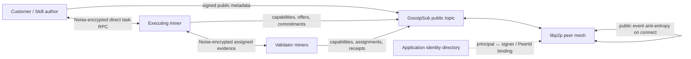

# P3: coordinator-free peer networking

## Architecture



The package is `@ai-mining-network/networking`. It supplies `PeerTransport`
(`createPeerTransport`) with two modes:

- `libp2p` is the network adapter. It composes TCP, Noise, Yamux, identify,
  GossipSub and mDNS. Production deployments must pass an active AMN identity
  resolver, a PeerId-to-principal resolver, and direct-message sender/recipient
  authorization callbacks. A persistent `storageDirectory` is mandatory.
- `local` is an explicitly insecure in-process test adapter. It is rejected if
  `deployment: "production"` or `productionRequired: true` is set. Supplying
  test-only libp2p transport modules also requires `testOnly: true` and is
  rejected for a production deployment.

No central marketplace server is needed for message exchange. Peer discovery
uses mDNS for local networks and optional static `bootstrapPeers` for remote
networks. A new remote node still needs at least one usable peer address or an
operator-provided discovery module; an open bootstrap peer is a seed, not a
required coordinator. The package currently does not include a DHT, rendezvous,
relay, or NAT traversal layer.

## Message policy and flow

```mermaid
sequenceDiagram
  participant E as Executor
  participant N as libp2p mesh
  participant R as Validators / peers
  E->>E: Sign canonical v2 envelope
  E->>N: Publish allowlisted public record
  N->>R: GossipSub (strict libp2p signatures)
  R->>R: Schema, EIP-712, expiry, identity, replay checks
  E->>R: Direct RPC only for CustomerTask/private payload
  Note over E,R: Noise encrypts the peer connection; receiver checks PeerId ↔ principal and authorization
  R->>E: Signed response envelope
  Note over N,R: On connection, bounded direct sync reconciles public event snapshots
```

`SkillManifest`, `SkillBenchmark`, `MinerCapabilities`, `ValidatorCapabilities`,
`MinerOffer`, `FixedPriceQuote`, `ExecutionContract`, `ExecutionCommitment`,
`VerificationAssignment`, `VerificationReceipt`, `VerificationDecision`,
`PaymentSettlement`, `SkillRating`, and `IdentityTransition` are public
GossipSub kinds. `CustomerTask` and any unrecognized/private kind are direct-only.
The direct transport never publishes private envelopes to the public topic or
inserts them in the public event store. Its built-in RPC frame is not an
artifact-transfer system: do not put customer files or plaintext output in
public messages. Larger private artifacts need the later encrypted storage
adapter (P4).

GossipSub validates strict sender signatures and then AMN validates canonical
JSON, the v2 payload schema, EIP-712 signature and current identity binding.
Direct messages use a readiness handshake followed by a bounded 4-byte
big-endian length frame. Noise authenticates the libp2p PeerId and encrypts the
connection. AMN separately verifies that the PeerId is mapped to the signed
principal and that the caller's authorization policy permits the sender or
recipient. A signed response must come from the principal mapped to the
connected peer.

Public messages are persisted before gossip. A remote peer reconnect performs
bounded anti-entropy: the deterministic initiating PeerId pushes active local
events, then pages the remote events back in stable
`createdAt/signer/messageId` order. Message IDs with changed bodies are
conflicts; duplicate identical IDs are idempotent in the event store. Expired
and revoked-identity events are not redistributed. This is eventual public
record convergence between connected peers, not total ordering or global
consensus. Gossip delivery is best-effort; reconnect sync repairs missed
public records.

## Configuration

```js
import { createPeerTransport } from "@ai-mining-network/networking";

const peer = await createPeerTransport({
  backend: "libp2p",
  storageDirectory: "/var/lib/amn/peer-1",
  listenAddresses: ["/ip4/0.0.0.0/tcp/0"],
  bootstrapPeers: ["/ip4/203.0.113.10/tcp/4001/p2p/12D3KooW..."],
  identityResolver,             // principalId -> ACTIVE signer and keyEpoch
  peerPrincipalResolver,        // authenticated libp2p PeerId -> principalId
  authorizePrivateSender,
  authorizePrivateRecipient,
});

await peer.publish(signedMinerCapabilities);
await peer.request(remotePeerId, signedCustomerTask);
```

Use explicit publicly reachable addresses and separately reviewed firewall,
key-custody and storage policies for real operators. The example address is
documentation-only. Do not reuse development identity keys. `getPeers()`,
`getPeerScores()`, `getPublicEvents()`, `onPeerChanges()` and
`onPublicMessages()` expose local peer state and events. Close the adapter with
`await peer.close()`.

Development commands:

```sh
pnpm test:networking
pnpm demo:networking
```

## Security guarantees and assumptions

Cryptographic guarantees are limited to the properties of the primitives:

- libp2p Noise authenticates the remote transport PeerId and encrypts bytes in
  transit on that connection.
- GossipSub strict signing authenticates a libp2p message as signed by the
  included PeerId key.
- AMN EIP-712 verifies the signed protocol envelope under the configured chain
  domain, and the active resolver binds that signer/key epoch to a local
  principal record.
- SHA-256 hashes detect changes to the bytes hashed; they do not prove AI
  execution or task correctness.

These mechanisms do not establish personhood, independent identities, fair
validator selection, honest execution, or Sybil resistance. Those require an
independently governed identity/eligibility and economic policy. A malicious
operator can create many keys; local peer scores are bounded abuse heuristics,
not shared reputation or slashing evidence. Noise protects data only in
transit; endpoint logs, storage, compromised peers, recipient access, and
plaintext task artifacts remain the application's responsibility.

Peer message limits include protocol payload and frame sizes, Gossipsub decode
and stream bounds, rate windows for bytes/messages, bounded local score history,
and a configurable peer connection ceiling. A low peer score disconnects only
that local node's peer connection. Scores do not affect escrow or payments.

## Dependency and license notes

This integration uses `libp2p` 3.5.x (MIT), `@libp2p/gossipsub` 17.2.x
(MIT), `@libp2p/tcp` 11.0.x (MIT), `@libp2p/noise` 17.0.x (MIT),
`@libp2p/yamux` 8.0.x (MIT), `@libp2p/identify` 4.1.x (MIT),
`@libp2p/mdns` 12.0.x (MIT), `@libp2p/crypto` 5.2.x (MIT),
`@multiformats/multiaddr` 13.0.x (MIT), and Ajv/Ajv Formats (MIT). The
`@libp2p/memory` (MIT) transport is a development-only dependency. Regenerate
the resolved package inventory after dependency changes; see
[`dependency-licenses.md`](../reports/dependency-licenses.md).

The adapter was checked against the official libp2p JS API and current installed
package declarations. libp2p pubsub does not perform peer discovery itself;
this implementation composes mDNS and optional operator bootstrap addresses.
The test adapter uses libp2p's memory transport to make peer protocol tests
deterministic; it is not a claim of public internet reachability.
